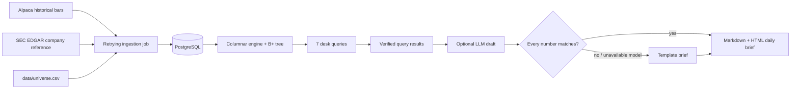

# Equities Data Platform with Verified AI Daily Brief

An end-of-day US equities pipeline for a curated liquid-stock universe. It ingests daily and minute bars into PostgreSQL, computes seven desk-style measures over a bounded in-memory columnar window, and writes a short Markdown and HTML market brief. The SQL parser and B+ tree are exercised by the engine benchmark. Every number in an AI-written brief is checked against the query results; if a number does not match, the draft is discarded and a template brief is saved instead.

> Status: PostgreSQL is the durable store and the custom engine is the default nightly analytics backend. The measured results below are from the recorded 2026-10-15 snapshot and should be rerun after any data, machine, or engine change.

## Architecture



## What it calculates

The versioned SQL files remain PostgreSQL parity specifications and benchmark baselines. The default engine backend returns the same named result sets from bounded in-memory columns; set `ANALYTICS_BACKEND=postgres` to compare the SQL implementation. Both paths bind the as-of date rather than interpolate user input.

| Query | Output |
| --- | --- |
| `01_returns.sql` | one-day return for every available symbol |
| `02_gainers_losers.sql` | top five gainers and losers |
| `03_volume_spikes.sql` | volume relative to the prior 20 sessions |
| `04_vwap.sql` | minute-bar session VWAP and range |
| `05_sector_performance.sql` | equal-weight sector return |
| `06_gaps.sql` | open versus previous close |
| `07_52_week_extremes.sql` | rolling 252-session highs and lows |

`companies.sector` uses reproducible, GICS-style groupings derived from EDGAR SIC codes plus liquid-universe overrides. It is a desk-style reference rather than licensed GICS or ICB taxonomy.

## Quick start

Prerequisites: Python 3.11+, Docker Desktop/Engine, an Alpaca market-data account, and a valid SEC User-Agent with contact information.

```bash
cp .env.example .env
# Edit .env: DATABASE_URL, Alpaca credentials, and SEC_USER_AGENT.
make up
make install
make backfill       # 365 calendar days daily; 30 calendar days minute
make nightly        # refresh data, query it, and create a brief
make test
```

Native PostgreSQL is also supported on macOS if Docker is unavailable: install it with Homebrew (`brew install postgresql@16`), start the service, create the database/user from `sql/init.sql`, and set `DATABASE_URL` in `.env`.

For LLM-written prose, choose `LLM_PROVIDER=anthropic`, `gemini`, `ollama`, or `openai`. Claude and Gemini use their respective API keys; Ollama is fully local, needs no key, and defaults to `llama3.2:3b` at `http://127.0.0.1:11434`. Install Ollama, then run `ollama pull llama3.2:3b` before using that provider. Any provider error, or a draft that fails numerical validation, automatically saves the deterministic verified brief instead.

Generated briefs land in `briefs/brief_YYYY-MM-DD.md` and `.html`. Pass `--as-of 2026-10-15` to any command when replaying a session:

```bash
PYTHONPATH=. .venv/bin/python -m market_brief.cli run-all --as-of 2026-10-15
```

The 100-symbol seed universe is deliberately editable. Keep it to liquid US-listed names and check provider symbol conventions and your data entitlement before adding symbols.

## Data-provider notes

This project uses `ALPACA_FEED=sip` for post-close historical requests, which was verified on the configured account. It caps SIP request end times at `now - 16 minutes`, avoiding delayed-data boundary errors during an evening run. The pipeline records the selected feed on every bar; use `iex` only if SIP entitlement is unavailable. Alpaca documents the difference between the feeds and historical `feed` parameter in its [Market Data FAQ](https://docs.alpaca.markets/us/docs/market-data-faq).

The SEC reference loader calls the ticker reference once, then reads each universe issuer's submissions profile to collect SIC metadata. It uses the configured identifying User-Agent and paces profile reads at roughly 9 per second. Extend EDGAR access conservatively: the SEC requests efficient scripts, an identifying User-Agent, and currently advises staying at or below 10 requests per second. See [SEC developer resources](https://www.sec.gov/about/developer-resources) and [Accessing EDGAR data](https://www.sec.gov/search-filings/edgar-search-assistance/accessing-edgar-data).

## Nightly scheduling

Use a host configured for `America/New_York`, or set `CRON_TZ` explicitly. The example runs at 6:05pm Eastern on weekdays after the regular US session. The script exits nonzero on ingestion or runtime failure and appends logs to `logs/nightly.log`; a rejected LLM draft instead falls back to the checked template brief.

```cron
CRON_TZ=America/New_York
5 18 * * 1-5 /absolute/path/to/repo/scripts/nightly.sh
```

Install it with `crontab -e` only after the manual `make nightly` succeeds. Cron has a minimal environment, so keep secrets in the repository-local `.env` (mode `600`) or inject them through a secrets manager; never place API keys in the crontab line.

## Verification model

The query results are the source of every numeric claim. Cloud LLM providers receive that result set; the local Ollama path rewrites an already-approved template brief. Before any draft is saved, the validator checks its numeric tokens against the relevant query result and ticker. A mismatch discards the draft and saves the same checked template. This reduces unsupported numeric claims, but it does not replace human review of qualitative language or market interpretation. In particular, it does not yet verify whether words such as “rose” or “fell” have the correct sign, or whether a valid number is attributed to the right measure (for example, a return versus a gap).

## Results

The engine architecture and reproducible benchmark protocol are in [`engine/README.md`](engine/README.md) and [`docs/benchmarks.md`](docs/benchmarks.md). The 2026-10-15 snapshot was rebuilt from **SIP** data and contains **100 symbols** and **1,121,108** minute bars. The harness ran one warmup plus **100** timed executions per case on a MacBook Air (Apple M3, 16 GB RAM, macOS 15.3.2, Python 3.14.7, PostgreSQL 16, DuckDB 1.5.6). Connection setup, hot-window loading, DuckDB table materialization, and the custom engine’s prebuilt per-symbol daily-row view were excluded from timing; the generated benchmark summary records that view’s setup cost. The engine and PostgreSQL implementations of all seven daily queries were also verified equal on this snapshot with `RUN_DB_INTEGRATION=1`.

| Workload | Custom engine median | PostgreSQL median | DuckDB median |
| --- | ---: | ---: | ---: |
| Daily 30-row range lookup | 0.041 ms | 0.240 ms | 0.504 ms |
| Minute 390-row range lookup | 0.868 ms | 0.534 ms | 0.734 ms |
| Sector return / group-by | 1.298 ms | 17.001 ms | 2.042 ms |

The custom engine wins the daily lookup because it executes against a preloaded in-process columnar window with no client/server round trip. PostgreSQL narrowly wins the minute lookup, while the custom engine and DuckDB both outperform PostgreSQL on this small sector aggregation. The sector speedup includes the prebuilt per-symbol daily-row view; the PostgreSQL parity query also evaluates `lag()` over each symbol’s available history before selecting the session. The custom engine remains a constrained learning implementation: its snapshot load cost and limited SQL grammar are real tradeoffs. Raw samples and the full benchmark summary are retained with the generated artifacts.
