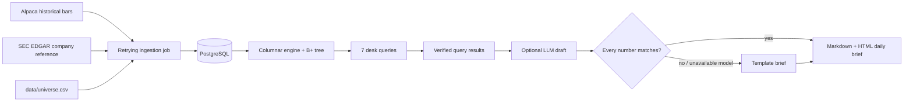

# Equities Data Platform with Verified AI Daily Brief

An end-of-day US equities pipeline for a curated liquid-stock universe. It ingests daily and minute bars into PostgreSQL, executes seven desk-style analytics queries on a custom in-memory engine, and writes a short Markdown and HTML market brief. Every number in an AI-written brief is checked against the query results; if a number does not match, the draft is discarded and a template brief is saved instead.

> Status: Phases 1–4 are implemented. PostgreSQL is the durable store and the custom engine is the default nightly analytics backend. The measured results below are from the recorded 2026-10-15 snapshot and should be rerun after any data, machine, or engine change.

## Architecture



## What it calculates

The versioned SQL files remain PostgreSQL parity specifications and benchmark baselines. The default engine backend returns the same named result sets from bounded in-memory columns; set `ANALYTICS_BACKEND=postgres` to compare the SQL implementation. Both paths bind the as-of date rather than interpolate user input.

| Query | Output |
| --- | --- |
| `01_returns.sql` | one-day return for every available symbol |
| `02_gainers_losers.sql` | top five gainers and losers |
| `03_volume_spikes.sql` | volume relative to the prior 20 sessions |
| `04_vwap.sql` | minute-bar session VWAP and range |
| `05_sector_performance.sql` | equal-weight sector return |
| `06_gaps.sql` | open versus previous close |
| `07_52_week_extremes.sql` | rolling 252-session highs and lows |

`companies.sector` is a coarse reproducible grouping derived from the issuer's EDGAR SIC code—not GICS. Treat the sector query as a desk-style reference; replace `sec_sector()` with licensed GICS/ICB mappings if institutional sector taxonomy is required.

## Quick start

Prerequisites: Python 3.11+, Docker Desktop/Engine, an Alpaca market-data account, and a valid SEC User-Agent with contact information.

```bash
cp .env.example .env
# Edit .env: DATABASE_URL, Alpaca credentials, and SEC_USER_AGENT.
make up
make install
make backfill       # 365 calendar days daily; 30 calendar days minute
make nightly        # refresh data, query it, and create a brief
make test
```

For LLM-written prose, choose `LLM_PROVIDER=anthropic`, `gemini`, `ollama`, or `openai`. Claude and Gemini use their respective API keys; Ollama is fully local, needs no key, and defaults to `llama3.2:3b` at `http://127.0.0.1:11434`. Install Ollama, then run `ollama pull llama3.2:3b` before using that provider. Any provider error, or a draft that fails numerical validation, automatically saves the deterministic verified brief instead.

Generated briefs land in `briefs/brief_YYYY-MM-DD.md` and `.html`. Pass `--as-of 2026-10-15` to any command when replaying a session:

```bash
PYTHONPATH=. .venv/bin/python -m market_brief.cli run-all --as-of 2026-10-15
```

The 100-symbol seed universe is deliberately editable. Keep it to liquid US-listed names and check provider symbol conventions and your data entitlement before adding symbols.

## Data-provider notes

This project currently uses `ALPACA_FEED=iex`. Its volume and VWAP calculations therefore use IEX trades only, not consolidated-market volume. `sip` remains a configuration option for accounts entitled to the consolidated feed; the pipeline records the selected feed on every bar. Alpaca documents the difference between the feeds and historical `feed` parameter in its [Market Data FAQ](https://docs.alpaca.markets/us/docs/market-data-faq).

The SEC reference loader calls the ticker reference once, then reads each universe issuer's submissions profile to collect SIC metadata. It uses the configured identifying User-Agent and paces profile reads at roughly 9 per second. Extend EDGAR access conservatively: the SEC requests efficient scripts, an identifying User-Agent, and currently advises staying at or below 10 requests per second. See [SEC developer resources](https://www.sec.gov/about/developer-resources) and [Accessing EDGAR data](https://www.sec.gov/search-filings/edgar-search-assistance/accessing-edgar-data).

## Nightly scheduling

Use a host configured for `America/New_York`, or set `CRON_TZ` explicitly. The example runs at 6:05pm Eastern on weekdays after the regular US session. The script exits nonzero on an ingestion or validation failure and appends logs to `logs/nightly.log`.

```cron
CRON_TZ=America/New_York
5 18 * * 1-5 /absolute/path/to/repo/scripts/nightly.sh
```

Install it with `crontab -e` only after the manual `make nightly` succeeds. Cron has a minimal environment, so keep secrets in the repository-local `.env` (mode `600`) or inject them through a secrets manager; never place API keys in the crontab line.

## Verification model

The query results are the source of every numeric claim. Cloud LLM providers receive that result set; the local Ollama path rewrites an already-approved template brief. Before any draft is saved, the validator compares its numeric tokens against the relevant query results. A mismatch discards the draft and saves the same checked template. This prevents unsupported numbers, but it does not replace human review of qualitative language or market interpretation.

## Results

The engine architecture and reproducible benchmark protocol are in [`engine/README.md`](engine/README.md) and [`docs/benchmarks.md`](docs/benchmarks.md). On the recorded 2026-10-15 snapshot of **100 symbols** and **715,594** bars, the harness ran one warmup plus **20** timed executions per case. Connection setup, hot-window loading, and DuckDB table materialization were excluded from timing.

| Workload | Custom engine median | PostgreSQL median | DuckDB median |
| --- | ---: | ---: | ---: |
| Daily 30-row range lookup | 0.253 ms | 0.331 ms | 0.589 ms |
| Minute 390-row range lookup | 7.198 ms | 0.548 ms | 0.624 ms |
| Sector return / group-by | 17.695 ms | 16.076 ms | 2.850 ms |

The custom engine narrowly wins the indexed daily lookup, while PostgreSQL is much faster for the minute workload. DuckDB wins the vector-friendly minute and group-by queries after typed data is materialized. The custom engine remains a constrained learning implementation: its preloaded columnar window avoids load cost, but its current range-scan and aggregation paths need further optimization. Raw samples and the full benchmark summary are retained with the generated artifacts.
