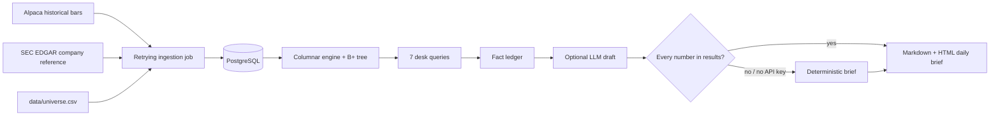

# Equities Data Platform with Verified AI Daily Brief

An end-of-day US equities pipeline for a curated liquid-stock universe. It ingests daily and minute bars into PostgreSQL, executes seven desk-style analytics queries on a custom in-memory engine, and writes a short Markdown and HTML market brief. An LLM can draft the prose, but a numerical gate rejects any claim not found in the exact query-result ledger; a deterministic verified fallback is always available.

> Status: Phases 1–4 are implemented. PostgreSQL is the durable store and the custom engine is the default nightly analytics backend. Benchmark code is included, but no performance figures are claimed until measured on the target machine.

## Architecture



## What it calculates

The versioned SQL files remain PostgreSQL parity specifications and benchmark baselines. The default engine backend returns the same named result sets from bounded in-memory columns; set `ANALYTICS_BACKEND=postgres` to compare the SQL implementation. Both paths bind the as-of date rather than interpolate user input.

| Query | Output |
| --- | --- |
| `01_returns.sql` | one-day return for every available symbol |
| `02_gainers_losers.sql` | top five gainers and losers |
| `03_volume_spikes.sql` | volume relative to the prior 20 sessions |
| `04_vwap.sql` | minute-bar session VWAP and range |
| `05_sector_performance.sql` | equal-weight sector return |
| `06_gaps.sql` | open versus previous close |
| `07_52_week_extremes.sql` | rolling 252-session highs and lows |

`companies.sector` is a coarse reproducible grouping derived from the issuer's EDGAR SIC code—not GICS. Treat the sector query as a desk-style reference; replace `sec_sector()` with licensed GICS/ICB mappings if institutional sector taxonomy is required.

## Quick start

Prerequisites: Python 3.11+, Docker Desktop/Engine, an Alpaca market-data account, and a valid SEC User-Agent with contact information.

```bash
cp .env.example .env
# Edit .env: DATABASE_URL, Alpaca credentials, and SEC_USER_AGENT.
make up
make install
make backfill       # 365 calendar days daily; 30 calendar days minute
make nightly        # refresh data, query it, and create a brief
make test
```

For LLM-written prose, choose `LLM_PROVIDER=anthropic`, `gemini`, `ollama`, or `openai`. Claude and Gemini use their respective API keys; Ollama is fully local, needs no key, and defaults to `llama3.2:3b` at `http://127.0.0.1:11434`. Install Ollama, then run `ollama pull llama3.2:3b` before using that provider. Any provider error, or a draft that fails numerical validation, automatically saves the deterministic verified brief instead.

Generated briefs land in `briefs/brief_YYYY-MM-DD.md` and `.html`. Pass `--as-of 2026-10-15` to any command when replaying a session:

```bash
PYTHONPATH=. .venv/bin/python -m market_brief.cli run-all --as-of 2026-10-15
```

The 100-symbol seed universe is deliberately editable. Keep it to liquid US-listed names and check provider symbol conventions and your data entitlement before adding symbols.

## Data-provider notes

The default `ALPACA_FEED=iex` is suitable for Alpaca's free market-data offering. `sip` is a configuration option only for accounts entitled to the consolidated feed; the pipeline records the selected feed on every bar. Alpaca documents the difference between the feeds and historical `feed` parameter in its [Market Data FAQ](https://docs.alpaca.markets/us/docs/market-data-faq).

The SEC reference loader calls the ticker reference once, then reads each universe issuer's submissions profile to collect SIC metadata. It uses the configured identifying User-Agent and paces profile reads at roughly 9 per second. Extend EDGAR access conservatively: the SEC requests efficient scripts, an identifying User-Agent, and currently advises staying at or below 10 requests per second. See [SEC developer resources](https://www.sec.gov/about/developer-resources) and [Accessing EDGAR data](https://www.sec.gov/search-filings/edgar-search-assistance/accessing-edgar-data).

## Nightly scheduling

Use a host configured for `America/New_York`, or set `CRON_TZ` explicitly. The example runs at 6:05pm Eastern on weekdays after the regular US session. The script exits nonzero on an ingestion or validation failure and appends logs to `logs/nightly.log`.

```cron
CRON_TZ=America/New_York
5 18 * * 1-5 /absolute/path/to/repo/scripts/nightly.sh
```

Install it with `crontab -e` only after the manual `make nightly` succeeds. Cron has a minimal environment, so keep secrets in the repository-local `.env` (mode `600`) or inject them through a secrets manager; never place API keys in the crontab line.

## Verification model

1. The versioned query definitions and equivalent engine calculations are the source of every numeric claim.
2. Result rows form a recursive fact ledger.
3. The LLM receives only that ledger and is asked for concise, attributed prose.
4. A numeric-token validator compares every generated number (including dates) to canonical values in the ledger. A mismatch discards the draft.
5. The deterministic writer is validated by the same gate before saving output.

This prevents unsupported numbers, but it is not a substitute for human review: qualitative causal language and semantic mistakes remain reasons to inspect the source query results.

## Engine, benchmarks, and resume evidence

The engine architecture and reproducible benchmark protocol are in [`engine/README.md`](engine/README.md) and [`docs/benchmarks.md`](docs/benchmarks.md). Fill in generated results only from saved measurements, then use those real figures in resume bullets such as:

- Built a nightly US-equities pipeline for **100 symbols**, backfilled **715,594** price bars, and generated a query-validated daily recap.
- Implemented a columnar engine with B+ tree range scans; on a 2026-10-15 snapshot it completed a daily range lookup in **0.245 ms median / 0.299 ms p95**, versus PostgreSQL at **6.142 ms / 9.889 ms** and DuckDB at **33.880 ms / 34.615 ms**.
- Benchmarked limitations honestly: PostgreSQL was faster for the minute-range and sector-group workloads (**6.582 ms** and **13.434 ms** median), compared with the custom engine (**7.241 ms** and **17.273 ms**).

These figures are from 20 timed iterations after one warmup. The raw samples and full summary are retained with the generated artifacts; rerun the benchmark after data, machine, or engine changes.
